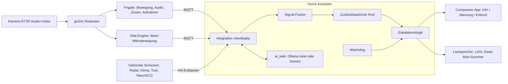

# HACheckBaby – Masterplan

Stand: 21.11.2026 · Status: Planungsphase, noch kein Code

Ein lokales, smartes Babyphone für Home Assistant, das auf Frigate aufsetzt und über HACS installiert wird. Es soll alles können, was ein klassisches Babyphone kann, und darüber hinaus die Lage im Bett bewerten: nicht nur „es bewegt sich etwas" oder „es ist laut", sondern „geht es dem Kind gut?".

---

## 1. Kurzfassung

- **Was wir bauen:** eine HACS-Integration (Arbeitsname-Domain `checkbaby`), die Signale aus Frigate (Weinen, Lautstärke, Bewegung, Zonen), optionalen Sensoren (mmWave-Radar, Raumklima, Türkontakt) und einem KI-Bewertungsmodell zu einem Kind-Zustand verdichtet und daraus dreistufige Benachrichtigungen ableitet (Info → Warnung → kritischer Push).
- **Drei Schichten, klar getrennt:**
  1. **Deterministische Erkennung** (Frigate + Schwellwerte + Timer). Sie trägt alle Alarme und funktioniert ohne KI und ohne Internet.
  2. **Vital-Engine** (eigener Prozess): Atem-Mikrobewegung aus dem Videobild, optional Radar. Startet im Schattenmodus, alarmiert erst nach Validierung.
  3. **KI-Lagebewertung** (multimodales Modell, lokal oder Cloud): Lage, Gesicht frei, Gefahren im Bett, wach/schlafend, Klartext-Begründung.
- **Wichtigste Designregel:** Die KI darf Alarme anreichern und (mit Bestätigung) hochstufen, aber niemals einen deterministischen Warn- oder Kritisch-Alarm unterdrücken.
- **Wichtigste Zuverlässigkeitsregel:** Ein Babyphone, das still ausfällt, ist schlimmer als keins. Der Watchdog („Überwachung ausgefallen") gehört deshalb in das MVP, nicht in eine spätere Version.
- **Zwei Punkte aus der Anforderung, die der Plan anders löst als ursprünglich gedacht** (Begründung in Abschnitt 2 und 6):
  - Atemstillstand lässt sich nicht mit einem Entscheidungsmodell wie Gemini erkennen. Dafür braucht es Signalverarbeitung bzw. Radar. Das Modell bekommt die Aufgaben, die es wirklich gut kann.
  - „Ohne Internet" und „Gemini" schließen sich aus. Der Plan macht den KI-Anbieter austauschbar: lokal (Ollama) als Standard, Gemini als bewusstes Opt-in.

---

## 2. Ehrliche Einordnung: was das System leisten kann

Dieser Abschnitt steht absichtlich vorne, weil er Architektur und Wortwahl bestimmt.

**Plötzlicher Kindstod (SIDS).** Kein Überwachungsgerät hat bisher nachgewiesen, dass es SIDS verhindert. Die American Academy of Pediatrics rät in ihrer Empfehlung von 2022 ausdrücklich davon ab, Heimmonitore als Strategie zur SIDS-Risikosenkung einzusetzen. Die Nutzung ist nicht schädlich, aber sie ersetzt die belegten Maßnahmen nicht: Rückenlage, feste flache Unterlage, eigenes Bett im Elternzimmer, keine losen Decken/Kissen/Kuscheltiere, nicht überwärmen, rauchfrei.

Daraus folgt für uns:

- Wir bauen ein **Aufmerksamkeits- und Komfortsystem**, kein Medizinprodukt. Es darf Eltern nie in falscher Sicherheit wiegen.
- Der größte reale Sicherheitsbeitrag liegt nicht im Atemalarm, sondern im **Safe-Sleep-Check**: Das System erkennt Bauchlage, verdecktes Gesicht, lose Gegenstände im Bett und zu warme Räume. Das sind genau die Risikofaktoren, bei denen Eingreifen nachweislich hilft, und genau die Aufgaben, die ein Bildmodell beherrscht.
- Der Atem-Hinweis kommt als zusätzliche Schicht, mit offen kommunizierter Fehlalarm- und Ausfallquote.
- **Wortwahl im öffentlichen Repo:** „Atembewegungs-Hinweis", nicht „Atemüberwachung" oder „SIDS-Schutz". Software, die mit dem Zweck beworben wird, physiologische Vorgänge zu überwachen oder Krankheiten zu verhindern, kann unter die EU-Medizinprodukteverordnung fallen. Für ein Hobbyprojekt ist das mit sauberer Zweckbestimmung und Disclaimer vermeidbar, sollte vor v1.0 aber einmal rechtlich geprüft werden.
- Empfehlung an alle Nutzer (und an uns selbst): ein einfaches Audio-Babyphone als Rückfallebene behalten. Das war auch der deutlichste Konsens im Reddit-Thread.

**Warum ein Entscheidungsmodell keinen Atemstillstand erkennt.** Atmung ist eine periodische Bewegung von Bruchteilen eines Pixels bei 0,3–1 Hz. Ein Sprach-/Bildmodell sieht einzelne Standbilder, braucht Sekunden für eine Antwort, antwortet nicht deterministisch und kann überzeugend falsch liegen. Für Atmung braucht es eine kontinuierliche Zeitreihe mit 5–10 Bildern pro Sekunde oder einen Radarsensor. Die Rollen sind deshalb getrennt:

| Aufgabe | Richtiges Werkzeug |
|---|---|
| Weinen, Schreien, Husten | Frigate-Audioerkennung + Dauer/Lautstärke-Logik |
| Bewegung, wach/unruhig, Kind steht | Frigate-Bewegung, Zonen, ggf. Frigate-Zustandsklassifikation |
| Atem-Mikrobewegung | Signalverarbeitung auf dem Videostream, mmWave-Radar |
| Lage, Gesicht frei, Gefahren im Bett, „sieht das normal aus?" | Multimodales KI-Modell |
| Klartext-Zusammenfassung, Nachtbericht | KI-Modell |

---

## 3. Recherche: was es schon gibt

**Ergebnis:** Eine HACS-Integration, die Frigate-Signale, Vital-Hinweise und KI-Bewertung zu einem Babyphone zusammenführt, existiert nicht. Es gibt Einzelbausteine:

| Kategorie | Beispiele | Was fehlt |
|---|---|---|
| Hersteller-Integrationen | Nanit, CuboAI, Philips Avent (Proxy), Owlet | Cloud-/Herstellerbindung, keine eigene Logik |
| Protokoll-Tools | Baby Buddy, Baby Tracker | Nur manuelles Tracking (Flasche, Windel, Schlaf) |
| DIY-Anleitungen | HA-Blog 2017 (`ffmpeg_noise`), techdout 2019, diverse Frigate-Guides | YAML-Bastelei, reine Lautstärkeschwelle, kein Watchdog, keine Eskalation |
| Atem-Forschungsprojekte | CribSense (Raspberry Pi, Video Magnification), respmon | Prototypen, nicht in HA integriert, teils zu rechenintensiv |
| Radar | Seeed MR60BHA2 (60 GHz, ESPHome, liefert Atem-/Herzrate) | Für Erwachsene bei 1,5 m ausgelegt, keine Validierung an Säuglingen |

**Was Frigate bereits liefert** (Details in Phase 0 am echten System verifizieren):

- Audioerkennung mit Labels wie `crying`, `scream`, `yell`, `speech`; nur `bark, fire_alarm, scream, speech, yell` sind Standard, `crying` muss explizit in `listen` aufgenommen werden. Schwelle je Label (Standard 0,8), `min_volume`, `max_not_heard`.
- MQTT pro Kamera: `audio/<label>` (ON/OFF), `audio/rms`, `audio/dBFS`, `motion`, dazu `frigate/events` und `frigate/reviews`.
- GenAI-Review-Zusammenfassungen (ab 0.17) mit Ollama oder Gemini. Für unsere Zwecke zu grob (Fokus: verdächtig/gefährlich im Sicherheitskontext), aber ein Beleg, dass der Ansatz trägt.
- go2rtc-Restream: ein Kamerazugriff, mehrere Abnehmer (Frigate, Live-Ansicht, unsere Vital-Engine).

**Lehren aus dem Reddit-Thread und den Anleitungen:**

1. Zuverlässigkeit schlägt Features. „Zum Laufen bringen" und „ein Jahr ohne Ausfall laufen" sind zwei verschiedene Dinge.
2. Reine Lautstärkeschwellen erzeugen zu viele Fehlalarme. Gewünscht: Dauer und Trend statt Ein/Aus (zehn Sekunden Quengeln ist kein Alarm).
3. Kritische Push-Nachrichten, die „Nicht stören" durchbrechen, sind der entscheidende Vorteil gegenüber normalem Push.
4. Schnappschuss oder Clip gehört in die Benachrichtigung, damit man ohne App-Start entscheiden kann.
5. „Wer hat Dienst?" (Mama/Papa/beide) als Umschalter, Türsensor für größere Kinder, Lampe im Elternschlafzimmer als stiller Kanal.
6. Kamerafalle: Viele günstige Kameras haben kein RTSP mehr oder RTSP ohne Ton. Eine geprüfte Hardwareliste ist Teil der Doku.
7. Live-Ton im HA-Frontend ist die bekannte Schwachstelle. Braucht eine eigene Lösung (siehe VOX-Audio).

---

## 4. Zielbild und Abgrenzung

**Ziele**

- Vollwertiger Ersatz für ein Video-Babyphone im eigenen Heimnetz, ohne Cloudzwang.
- Wenige, verlässliche Alarme in drei Stufen statt vieler Bewegungsmeldungen.
- Einrichtung komplett über die Oberfläche (Config Flow), kein YAML für den Normalfall.
- Jede Entscheidung des Systems ist nachvollziehbar (Ereignisprotokoll mit Ursache).
- Zweisprachig Deutsch/Englisch wie bei KostalKore und InverterChargeNight.

**Nicht-Ziele**

- Kein Medizinprodukt, keine Diagnose, keine garantierte Erkennung.
- Kein eigener NVR: Aufzeichnung, Objekterkennung und Audioerkennung bleiben bei Frigate.
- Keine Reiselösung. Unterwegs bleibt ein einfaches Gerät sinnvoll.

**Voraussetzungen beim Nutzer**

- Home Assistant mit MQTT-Broker, Frigate (Mindestversion in Phase 0 festlegen, Vorschlag ≥ 0.16) mit go2rtc.
- Kamera mit RTSP **und** Audio (AAC), brauchbares Infrarot-Nachtbild, Montage möglichst senkrecht über dem Bett, Kabel außer Reichweite (mindestens 1 m).
- Companion-App auf den Eltern-Handys.
- Optional: Rechner mit GPU für ein lokales Bildmodell, mmWave-Radar, Raumklimasensor.

---

## 5. Architektur



### 5.1 Komponenten

**A. Integration `checkbaby` (HACS, `custom_components/`)** – das eigentliche Produkt. Orchestriert, rechnet aber nichts Schweres. `iot_class: local_push`, `integration_type: device`, ein Config-Eintrag pro Kind/Bett.

**B. Vital-Engine (ab Phase 3, eigener Container/Add-on)** – zieht den Substream aus go2rtc, berechnet Atem-Mikrobewegung und veröffentlicht Ergebnis plus Signalqualität per MQTT. Bewusst getrennt von Home Assistant: Dauerhafte Videodekodierung im HA-Prozess gefährdet bei Fehlern oder Speicherlecks die gesamte Hausautomation. HACS kann keine Add-ons installieren; das Add-on-Repository kann aber im selben GitHub-Repo liegen, für HA-Container-Nutzer gibt es eine Compose-Datei. Ob Monorepo oder zweites Repo, klärt der Spike in Phase 0.

**C. Frigate** – unverändert, nur Konfigurationsempfehlung (Audio-Rolle, `listen: [crying, scream, yell]`, Zone „Bett").

### 5.2 Aufbau der Integration

Orientiert an InverterChargeNight: Home-Assistant-freie Logikmodule, die sich ohne HA testen lassen, und dünne Plattform-Dateien.

```
custom_components/checkbaby/
  __init__.py  config_flow.py  const.py  coordinator.py  entity.py
  sources/      frigate_mqtt.py, entity_source.py, engine_mqtt.py   (Signalquellen hinter einer Schnittstelle)
  fusion.py                 Signale -> Evidenz (reine Logik)
  state_machine.py          Kind-Zustand (reine Logik)
  escalation.py             Stufen, Quittierung, Schlummern, Sperrzeiten (reine Logik)
  notifier.py               iOS-/Android-Payloads, Aktionen, Anhänge
  ai/                       assessor.py, prompts.py, schema.py, budget.py
  watchdog.py               Herzschlag aller Quellen
  sleep_log.py              Schlafprotokoll (Store)
  binary_sensor.py sensor.py switch.py select.py number.py button.py event.py
  services.py services.yaml diagnostics.py icons.json strings.json translations/{de,en}.json
  quality_scale.yaml
```

### 5.3 Zustandsautomat

Zustände: `leer` · `schläft` · `unruhig` · `wach` · `weint` · `betreut` (Erwachsener im Bild, Alarme pausiert) · `unbekannt` (Signal unbrauchbar).

Übergänge hängen an Dauer und Kombination, nicht an Einzelereignissen. Beispiel: `schläft → unruhig` bei Bewegung über 20 s oder Laut über Schwelle; `unruhig → weint` erst bei `crying` über 8 s oder ansteigendem Pegel; zurück nach 2 min Ruhe. Alle Zeiten sind einstellbar und über Altersprofile vorbelegt (Neugeborenes, Säugling, Kleinkind).

### 5.4 Eskalationsmatrix (Startwerte)

| Auslöser | Quelle | Stufe |
|---|---|---|
| Bewegung im Schlaf, kurzes Quengeln | Frigate | Info (nur Protokoll/Dashboard) |
| Kind wach und ruhig | Bewegung + KI | Info, Push optional |
| Weinen anhaltend (Standard ≥ 15 s) | Audio | Warnung |
| Weinen unquittiert ≥ 3 min oder Schrei mit hoher Konfidenz | Audio | Kritisch |
| Kleinkind steht/klettert, verlässt Bett, Tür geht auf | Zone, KI, Türkontakt | Warnung bis Kritisch |
| Bauchlage (Altersprofil < 12 Mon.), Gesicht verdeckt | KI, zwei Prüfungen in Folge | Warnung, bei Bestätigung Kritisch |
| Lose Decke/Gegenstand im Bett | KI | Info/Warnung (Safe-Sleep-Hinweis) |
| Keine Atem- und Körperbewegung ≥ 20 s bei gültigem Signal | Engine und/oder Radar | Kritisch (erst nach Schattenmodus) |
| Raumtemperatur/Luftfeuchte außerhalb Bereich | Sensor | Info/Warnung |
| Rauch/CO im Kinderzimmer | Sensor | Kritisch (Durchreichung) |
| Überwachung ausgefallen (Kamera, Frigate, MQTT, Engine) | Watchdog | Warnung, im scharfen Zustand nach N min Kritisch |

**Stufen technisch:**

- **Info:** kein Ton, Eintrag im Protokoll.
- **Warnung:** normaler Push mit Schnappschuss und Aktionen (Gesehen · Schlummern 5 min · Live öffnen).
- **Kritisch:** iOS Critical Alert (`critical: 1`, volle Lautstärke) bzw. Android Alarm-Kanal (`channel: alarm_stream`, `priority: high`, `ttl: 0`), Wiederholung bis zur Quittierung, danach Eskalationskette: zweiter Elternteil → Lautsprecher/TTS → Licht im Elternschlafzimmer.

**Grundregeln:** Quittierung stoppt die Kette, nicht die Überwachung. Sperrzeiten gegen Alarmmüdigkeit gelten nie für Kritisch. „Wer hat Dienst?" steuert das erste Ziel, die Eskalation erreicht immer alle.

### 5.5 KI-Lagebewertung

- **Anbindung über `ai_task`** von Home Assistant. Der Nutzer wählt eine beliebige AI-Task-Entität (Ollama, Google Gemini, OpenAI …); wir liefern Anweisung, Bilder und ein festes Antwortschema. Damit pflegen wir keine Anbieter-SDKs und keine API-Schlüssel. Die Python-Schnittstelle und das Anhängen eigener Schnappschüsse sind in Phase 0 zu verifizieren (es gibt Forenberichte über Probleme mit Anhängen bei einzelnen Anbietern). Rückfallebene: direkter Anbieter-Client.
- **Annahme:** Mit „Google Gemini" ist ein multimodales Gemini-Flash-Modell gemeint. Lokal kommen Bildmodelle über Ollama in Frage; die Auswahl wird in Phase 0 mit Infrarotbildern getestet, weil Nachtbilder für Bildmodelle deutlich schwieriger sind.
- **Auslöser:** ereignisgesteuert (Weinen, Aufwachen, lange Reglosigkeit, Lagewechsel), periodischer Routine-Check im Schlafmodus (Standard alle 10 min), manuell per Button/Aktion.
- **Eingabe:** 3–4 Bilder über wenige Sekunden als Serie, dazu Kontext (Zustand, Schlafdauer, Pegel, Raumtemperatur, Altersprofil). Audio-Clips nur bei Modellen, die Audio verstehen.
- **Ausgabe (festes Schema):** `presence`, `position` (Rücken/Bauch/Seite/sitzt/steht/unklar), `face_visible`, `airway_risk` (keins/möglich/wahrscheinlich), `state`, `hazards[]`, `assessment` (ok/Hinweis/Warnung/kritisch), `confidence`, `reason` (ein Satz in Nutzersprache).
- **Leitplanken:**
  - KI allein löst höchstens „Warnung" aus. „Kritisch" nur bei definierter Gefahr und zweiter Prüfung mit frischem Bild (2 aus 2).
  - KI kann Info-Ereignisse still halten („dreht sich im Schlaf"), aber keine Warn-/Kritisch-Alarme aus deterministischen Quellen unterdrücken.
  - Zeitüberschreitung oder Fehler: Es gilt die deterministische Stufe, `binary_sensor.ki_verfuegbar` geht auf aus.
  - Budget: maximale Aufrufe pro Stunde, Sperrzeit zwischen Routine-Checks.
- **Datenschutz:** Standard ist lokal. Cloud-Anbieter nur nach ausdrücklicher Bestätigung im Config Flow, mit Hinweis, dass Bilder des Kindes das Haus verlassen und je nach Tarif zum Training genutzt werden können. Bilder werden nicht dauerhaft gespeichert, außer der Nutzer schaltet das Fehlersuch-Archiv ein.

### 5.6 Vital-Engine (Atembewegungs-Hinweis)

- **Verfahren:** Bildausschnitt über dem Oberkörper (aus Bett-Zone, später automatisch), Graustufen, verkleinert, 5–10 Bilder/s. Bewegungssignal, Bandpass 0,3–1,5 Hz, Periodizität über 20–30 s Fenster, Signal-Rausch-Verhältnis als Konfidenz. Volle Eulerian Video Magnification ist laut Vorprojekten zu teuer; einfache Verfahren (Pixelintensität, optischer Fluss) reichen als Start.
- **Ausgabe:** `periodische_bewegung` · `grobe_bewegung` (Kind bewegt sich, Atmung nicht messbar, aber unkritisch) · `keine_bewegung` · `signal_unbrauchbar` (verdeckt, Kind nicht im Bild, Bildrauschen), dazu geschätzte Rate und Konfidenz.
- **Alarmbedingung:** Kind anwesend **und** Signal war zuvor gültig **und** weder periodische noch grobe Bewegung für ≥ 20 s. „Signal unbrauchbar" ist nie ein Alarm, sondern ein sichtbarer Zustand.
- **Fusion mit Radar:** Wenn ein mmWave-Sensor vorhanden ist, entscheidet einstellbar „eine Quelle genügt" (empfindlich) oder „beide Quellen" (weniger Fehlalarme).
- **Schattenmodus:** Mindestens zwei Wochen nur protokollieren, Trefferquote und Fehlalarme auswerten, erst dann Alarme freigeben. Der Schalter für den Atemalarm ist standardmäßig aus und trägt einen deutlichen Hinweistext.
- **Bekannte Grenzen:** Pucksack/dicke Decken, Seitenlage mit Rücken zur Kamera, Ventilator oder Mobile im Bildausschnitt, flacher Kamerawinkel, Bildrauschen bei Infrarot. Diese Liste gehört in die Nutzerdoku.

### 5.7 Watchdog

- Herzschlag je Quelle: Kamerabild-Alter, Frigate `available`, MQTT-Verbindung, letzte Audiopegel-Meldung, Engine, KI-Erreichbarkeit, Push-Zustellbarkeit.
- Sammelsensor `binary_sensor.<kind>_ueberwachung_ok` plus Diagnosesensoren je Quelle.
- Testalarm-Button und optionaler täglicher Selbsttest (stille Zustellprüfung).
- **Externer Dead-Man:** Fällt Home Assistant selbst aus, kann es niemanden warnen. Lösung: kleines ESPHome-Gerät mit Summer im Elternschlafzimmer, das einen regelmäßigen Herzschlag erwartet und bei Ausbleiben selbst piept. Entspricht dem „Verbindung verloren"-Ton klassischer Babyphone.

### 5.8 Entitäten und Aktionen (Auszug)

| Typ | Entitäten |
|---|---|
| `sensor` | Zustand, Alarmstufe, Geräuschpegel, Atemrate (geschätzt) + Konfidenz, letzte Bewegung, Schlaf seit, Schlafdauer, Aufwachen heute Nacht, letzte KI-Bewertung, Lage |
| `binary_sensor` | weint, Bewegung, wach, im Bett, betreut, Atembewegung erkannt, Überwachung ok, KI verfügbar |
| `switch` | Überwachung scharf, KI-Bewertung, Atemalarm, VOX-Audio, Privatmodus |
| `select` | Modus (Aus/Nacht/Nickerchen/Babysitter), Empfindlichkeit, wer hat Dienst |
| `number` | Wein-Dauer bis Warnung, Pegelschwelle, Reglos-Zeit, KI-Intervall |
| `button` | Testalarm, KI-Check jetzt, Quittieren, Schlummern |
| `event` | Alarmereignisse für eigene Automationen |
| Aktionen | `assess_now`, `acknowledge`, `snooze`, `test_alert`, `start_sleep`, `end_sleep` |

---

## 6. Feature-Brainstorming

Legende: **M** = MVP (Phase 1), **2–5** = geplante Phase, **?** = Idee, noch zu bewerten.

**A. Gleichstand mit dem klassischen Babyphone**

- **M** Wein- und Geräuschalarm mit Dauer-/Trendlogik statt Lautstärkeschwelle
- **M** Live-Bild und Ton im Dashboard (go2rtc/WebRTC)
- **M** Verbindungs-/Ausfallalarm (Watchdog)
- **4** VOX-Audio: Kinderzimmerton automatisch auf einen Lautsprecher im Elternschlafzimmer legen, sobald es laut wird, und nach Ruhe wieder stumm schalten. Löst das Problem „Ton im HA-Frontend" und ist die Kernfunktion jedes Audio-Babyphones.
- **4** Gegensprechen über go2rtc (kameraabhängig)
- **4** Einschlafhilfe: Schlaflied/weißes Rauschen, Nachtlicht, Abschalt-Timer
- **4** Raumtemperatur und Luftfeuchte mit Empfehlungsbereich
- **M** Geräuschpegel-Anzeige als Ersatz für die LED-Leiste
- **4** Schwenken/Neigen und Presets, falls die Kamera es kann
- **4** Batteriewarnung für beteiligte Funksensoren

**B. Besser als ein Babyphone: Erkennung**

- **2** Safe-Sleep-Check per KI: Lage, Gesicht frei, lose Gegenstände
- **2** „Kind ist wach, aber zufrieden" von „braucht jemanden" unterscheiden
- **2** Betreuungserkennung: Erwachsener im Zimmer pausiert Alarme automatisch und schaltet danach wieder scharf
- **3** Atembewegungs-Hinweis aus Video, optional Radar
- **2** Kleinkind steht auf, klettert, verlässt das Bett; Türkontakt als zweites Signal
- **2** Husten-Erkennung und Hustenhäufigkeit pro Nacht (Audio-Label vorhanden)
- **?** Frigate-Zustandsklassifikation (eigenes kleines Modell „Bett leer / schläft / wach") als lokale, schnelle Alternative zur KI für Standardfälle
- **?** Druck-/Belegungssensor unter der Matratze als weitere unabhängige Quelle
- **?** Wearables (z. B. Owlet über vorhandene Integration) als optionale Signalquelle
- **?** Schrei-Klassifikation (Hunger/Schmerz/Müdigkeit): Forschung existiert, Verlässlichkeit fraglich; höchstens als gekennzeichnetes Experiment
- **5** Luftqualität (CO₂) mit Lüftungshinweis; Rauch/CO-Durchreichung als Kritisch

**C. Benachrichtigung und Eskalation**

- **M** Drei Stufen mit kritischem Push, Schnappschuss, Aktionsknöpfen
- **M** Quittieren und Schlummern
- **2** Kurzer Clip mit Ton in der Benachrichtigung
- **4** „Wer hat Dienst?" mit Übergabe und Eskalation zum zweiten Elternteil
- **4** Stille Kanäle: Lampe im Elternschlafzimmer (Farbe je Stufe), Vibration auf der Smartwatch
- **4** Anwesenheitsabhängig: Tagsüber im Wohnzimmer TV-Einblendung oder Wandtablet statt Handyalarm
- **4** Babysitter-/Gästemodus: befristetes Zielgerät, vereinfachte Ansicht, konservativere Schwellen
- **?** Telefonanruf als letzte Eskalationsstufe

**D. Schlaf-Analyse**

- **5** Automatisches Schlafprotokoll: Einschlafzeit, Aufwachphasen, Dauer, Zeit bis zur Beruhigung
- **5** Nachtbericht am Morgen als KI-Zusammenfassung mit Zeitleiste und Clips
- **5** Wochen- und Monatstrends, Zusammenhang mit Temperatur, Geräusch, Uhrzeit
- **5** Übergabe an Baby Buddy
- **?** Vorhersage „wacht vermutlich in 20 min auf" aus Unruhemustern

**E. Zuverlässigkeit und Betrieb**

- **M** Testalarm, Diagnose-Download, Ereignisprotokoll mit Ursache
- **M** Repair-Hinweise bei Fehlkonfiguration (kein Audio im Stream, `crying` nicht aktiviert, keine Critical-Berechtigung)
- **3** Dead-Man-Summer (ESPHome)
- **3** Schattenmodus für jede neue Erkennung
- **6** Wiedergabe-/Simulationsmodus: aufgezeichnete Szenarien einspielen, um Schwellen zu testen
- **?** Doku-Empfehlungen: USV, Kamera per Firewall vom Internet trennen, Zweitgerät als Rückfallebene

**F. Bedienung**

- **M** Beispiel-Dashboard (YAML) in Deutsch und Englisch
- **5** Eigene Karte mit Live-Bild, Zustand, Pegel und Quittier-Knopf (wird mit der Integration ausgeliefert)
- **M** Privatmodus (Erkennung und Benachrichtigung pausieren, z. B. beim Stillen)
- **4** Automatisch scharf: Zeitplan, „Kind im Bett + Tür zu", oder manuell
- **5** Blueprints für typische Automationen

---

## 7. Umsetzung in Phasen

**Phase 0 – Fundament und Machbarkeit**

- Repo-Gerüst nach Vorlage InverterChargeNight: `custom_components/`, `hacs.json`, `manifest.json`, CI (pytest, mypy und pyright strikt, hassfest, HACS-Action, HA-Matrix älteste/neueste Version), `AGENTS.md`, Doku-Struktur `docs/de` und `docs/en`, Issue-Vorlagen, Coverage-Ratsche.
- Spikes am echten System:
  1. Frigate: Audio-Labels, MQTT-Payloads, Latenz Weinen → MQTT.
  2. `ai_task`: Aufruf aus Python, eigene Bildserien als Anhang, strukturiertes Ergebnis; Vergleich lokales Modell gegen Gemini mit Tag- und Infrarotbildern.
  3. go2rtc: Ton auf Lautsprecher (Format, Latenz), Substream für die Engine.
  4. Engine: Atemsignal aus aufgezeichnetem Testmaterial (Erwachsener, Puppe mit Motor) als Machbarkeitsbeweis.
- Entscheidungen aus Abschnitt 9 treffen.
- **Fertig, wenn:** leere Integration installiert sich über HACS, CI ist grün, vier Spike-Notizen liegen vor.

**Phase 1 – MVP v0.1: klassisches Babyphone, nur verlässlicher**

Config Flow (Kind, Frigate-Kamera, Benachrichtigungsziele, Altersprofil), Frigate-Quelle, Zustandsautomat, Eskalation mit drei Stufen, Quittieren/Schlummern, Scharf/Unscharf und Modi, Watchdog, Testalarm, Diagnose, Beispiel-Dashboard, Übersetzungen.
**Fertig, wenn:** zwei Wochen Parallelbetrieb neben einem gekauften Babyphone ohne verpasstes Weinen und ohne unbemerkten Ausfall.

**Phase 2 – v0.2: KI-Lagebewertung**

`ai_task`-Anbindung, Schema, Leitplanken, Safe-Sleep-Check, Betreuungserkennung, Budget, Datenschutz-Opt-in, Clip in der Benachrichtigung.
**Fertig, wenn:** auf einem beschrifteten Testsatz eigener Szenen (Tag/Nacht) Trefferquote und Fehlalarmquote dokumentiert sind und die KI nachweislich keinen deterministischen Alarm unterdrücken kann (Tests).

**Phase 3 – v0.3: Vital-Engine im Schattenmodus**

Engine-Container/Add-on, MQTT-Vertrag, Fusion mit Radar, Dead-Man-Summer, Auswertung des Schattenbetriebs.
**Fertig, wenn:** Auswertung über mindestens 14 Nächte vorliegt und über die Freigabe des Alarms entschieden ist.

**Phase 4 – v0.4: Komfort**

VOX-Audio, Gegensprechen, Einschlafhilfe, Raumklima, Dienstplan, stille Kanäle, Babysitter-Modus, automatisches Scharfschalten.

**Phase 5 – v0.5: Schlaf-Analyse und Oberfläche**

Schlafprotokoll, Nachtbericht, Trends, Baby-Buddy-Anbindung, eigene Karte, Blueprints.

**Phase 6 – v1.0: Härtung und Veröffentlichung**

Szenario-Labor (Compose mit HA, Mosquitto, Frigate und go2rtc, das Testvideos als RTSP-Kamera einspielt), Quality Scale, vollständige zweisprachige Doku inklusive Grenzen und Hardwareliste, rechtliche Prüfung der Zweckbestimmung, Aufnahme in die HACS-Standardliste.

---

## 8. Qualität und Tests

- Logikmodule (`fusion`, `state_machine`, `escalation`, `ai/schema`) ohne HA-Abhängigkeit, mit Szenariotests aus aufgezeichneten Ereignisfolgen („Nacht mit dreimal Aufwachen", „Kamera fällt um 02:10 aus").
- Sicherheitsrelevante Invarianten als eigene Tests: KI unterdrückt keinen Alarm; Kritisch ignoriert Sperrzeiten; „Signal unbrauchbar" erzeugt nie „alles ok"; Ausfall jeder einzelnen Quelle führt zu einer Meldung.
- Strikte Typprüfung und Coverage-Ratsche wie in InverterChargeNight.
- Testmaterial: frei lizenzierte Audiodatensätze für Weinen, selbst gestellte Szenen. Keine echten Kinderaufnahmen im Repository.
- Jede neue Erkennung durchläuft den Schattenmodus, bevor sie alarmieren darf.

---

## 9. Risiken und offene Entscheidungen

| Risiko | Gegenmaßnahme |
|---|---|
| Falsche Sicherheit bei den Eltern | Klare Zweckbestimmung, Disclaimer im Setup, Zustand „unbekannt" sichtbar, Rückfallgerät empfohlen |
| Stiller Ausfall | Watchdog im MVP, Dead-Man-Summer, Selbsttest |
| Alarmmüdigkeit | Dauer-/Trendlogik, Altersprofile, Schattenmodus, KI filtert nur Info-Stufe |
| KI halluziniert oder fällt aus | Festes Schema, 2-aus-2 für Kritisch, deterministische Schicht bleibt führend |
| Kinderbilder in der Cloud | Lokal als Standard, ausdrückliches Opt-in, keine Dauerspeicherung |
| Infrarot-Nachtbild zu schlecht für Bildmodell oder Atemsignal | Früh in Phase 0 testen, Kamera- und Montageempfehlung |
| Frigate-/HA-Schnittstellen ändern sich | Quellen hinter einer Schnittstelle, CI gegen älteste und neueste HA-Version |
| Einstufung als Medizinprodukt | Wortwahl, keine Heilsversprechen, Prüfung vor v1.0 |

**Offene Entscheidungen (mit Empfehlung):**

1. **Name/Domain:** `checkbaby` als Domain, Anzeigename „HACheckBaby". *Empfehlung: so übernehmen.*
2. **KI-Standard:** strikt lokal oder Cloud erlaubt? *Empfehlung: beides unterstützen, lokal als Standard, Gemini als Opt-in.*
3. **Vital-Engine:** eigener Container/Add-on oder im HA-Prozess? *Empfehlung: eigener Container, nach Spike endgültig.*
4. **Frigate-Anbindung:** direkt per MQTT oder über die Entitäten der Frigate-Integration? *Empfehlung: MQTT als Hauptweg, Entitäten als Rückfall.*
5. **Vorhandene Hardware:** Welche Kamera, welcher Frigate-Rechner (GPU?), Alter des Kindes? Bestimmt Altersprofil, Modellwahl und die Reihenfolge der Phasen 2 und 3.

---

## 10. Quellen

- [AAP: aktualisierte Safe-Sleep-Empfehlungen 2022](https://www.aap.org/en/news-room/news-releases/aap/2022/american-academy-of-pediatrics-updates-safe-sleep-recommendations-back-is-best)
- [Frigate: Audio-Erkennung](https://docs.frigate.video/configuration/audio_detectors) · [MQTT](https://docs.frigate.video/integrations/mqtt) · [GenAI-Konfiguration](https://docs.frigate.video/configuration/genai/genai_config) · [Review-Zusammenfassungen](https://docs.frigate.video/configuration/genai/genai_review) · [Release 0.17](https://github.com/blakeblackshear/frigate/releases/tag/v0.17.0)
- [Frigate-Diskussion: Weinen nicht erkannt](https://github.com/blakeblackshear/frigate/discussions/10241) · [Beispielkonfiguration crying/scream/yell](https://github.com/blakeblackshear/frigate/issues/8171)
- [Home Assistant: AI Task](https://www.home-assistant.io/integrations/ai_task/) · [Entwicklerdoku](https://developers.home-assistant.io/docs/core/entity/ai-task) · [Forenbericht zu Bildanhängen](https://community.home-assistant.io/t/ai-task-generate-data-and-local-image-file-to-analyze/953555)
- [Companion-App: kritische Benachrichtigungen](https://companion.home-assistant.io/docs/notifications/critical-notifications)
- [Home Assistant Blog 2017: Smart Baby Monitor](https://www.home-assistant.io/blog/2017/02/03/babyphone/) · [FFmpeg Noise](https://www.home-assistant.io/integrations/ffmpeg_noise)
- [Forum: Baby monitor – any options to consider?](https://community.home-assistant.io/t/parents-baby-monitor-any-options-to-consider/664927)
- [CuboAI-Integration](https://github.com/niruse/cuboai) · [Baby Buddy für Home Assistant](https://github.com/jcgoette/baby_buddy_homeassistant)
- [CribSense](https://lukehsiao.github.io/CribSense) · [respmon](https://github.com/kevroy314/respmon) · [Vergleich von Verfahren zur Atemerkennung per Video](https://ar5iv.labs.arxiv.org/html/2211.16046)
- [ESPHome: Seeed MR60BHA2](https://esphome.io/components/seeed_mr60bha2/)

Hinweis zur Recherche: Die drei verlinkten Artikel (localsmarthomeguide, HA-Blog 2017, techdout) waren aus der Arbeitsumgebung nicht direkt abrufbar. Der HA-Blogartikel ist über Suchergebnisse inhaltlich abgedeckt, der techdout-Artikel über den mitgelieferten Reddit-Thread; der localsmarthomeguide-Artikel wurde nicht gelesen. Angaben zu Frigate und `ai_task` stammen aus Dokumentation und Suchergebnissen und werden in Phase 0 am laufenden System überprüft.
